# RECETARIO MAESTRO CON FOTOS & BÓVEDA CULINARIA DE FLORENCIA

**Atleta & Diseñadora:** Florencia Schmidt  
**Líneas Clínicas:** Hipotiroidismo Primario (conversión T4 a T3), 100% Sin Gluten Estricto, Salud Intestinal (cero hinchazón, activación de motilidad), Equilibrio Hormonal & DIU Kyleena  
**Directorio Fotográfico:** Todas las imágenes están almacenadas localmente en `images/` y son fotos reales de alta fidelidad culinaria.

---

## 📸 INVENTARIO DE FOTOGRAFÍAS REALES DEL REPOSITORIO (`images/`)

Este banco de imágenes locales cubre todas las comidas del sistema. Toda receta futura debe reutilizar estas imágenes o utilizar directamente las fotografías de las creadoras de Instagram/Substack para no generar imágenes artificiales innecesarias.

| Imagen (`images/`) | Tamaño | Plato / Preparación Representada | Autora / Origen Inspiración | Usos en la App |
| :--- | :--- | :--- | :--- | :--- |
| **`arepas_pan.jpg`** | 146 KB | Arepas doradas de harina P.A.N. con chía, revuelto campero y cottage | Tradicional adaptado antiinflamatorio | Desayuno Lun, Mié, Vie y Swapper |
| **`snickers_oats.jpg`** | 755 KB | Snickers Overnight Oats con caramelo de cacahuete y capa crujiente de chocolate | Erth & Me (@erth.and.me) | Desayuno Jue y Swapper |
| **`pancakes_avena.jpg`** | 50 KB | Pancakes dorados de avena sin gluten, proteína AMIX y canela | Receta clásica Batch Cooking | Desayuno Mar, Batch Cooking y Swapper |
| **`waffles_avena.jpg`** | 137 KB | Waffles esponjosos de avena sin gluten y claras con frutos rojos | Receta adaptada fitness | Desayuno Dom y Swapper |
| **`crepes_dulces.jpg`** | 125 KB | Crepes finos de avena sin gluten con frutos rojos y canela | Receta pre-entreno O2 | Desayuno Sáb (Pre-Barre) |
| **`pavo_asado.jpg`** | 835 KB | Solomillitos de pavo al limón y romero con dados de boniato/patata dorada | AJ Foodie (@ajfoodie) | Almuerzo Lun, Sáb y Swapper |
| **`quinoa_bowl.jpg`** | 72 KB | Mediterranean Quinoa Crunch Bowl con pollo dorado, verduras y tahini | The Anti-Inflammatory Club | Almuerzo Mar, Dom y Swapper |
| **`pollo_arroz.jpg`** | 64 KB | Wok de ternera/pollo salteado con calabacín, orégano y arroz basmati | AJ Foodie (@ajfoodie) | Almuerzo Mié, Vie y Swapper |
| **`garbanzos_gambas.jpg`** | 176 KB | Sartenada express de garbanzos lavados con ternera magra y espinacas | Receta de legumbre limpia digestiva | Almuerzo Jue |
| **`hamburguesa.jpg`** | 873 KB | Hamburguesa casera de ternera con queso havarti fundido y tortitas de maíz | Receta limpia sin pan con gluten | Almuerzo Swapper y Cena Jue |
| **`salmon_plancha.jpg`** | 34 KB | Lomo de salmón fresco a la plancha con piel crujiente y ensalada | Bóveda Omega-3 | Almuerzo & Cena (Swapper) |
| **`fishcakes_salmon.jpg`** | 821 KB | Pastelitos dorados de salmón fresco y boniato (Fishcakes) | The Anti-Inflammatory Club | Almuerzo Swapper |
| **`camarones_cherrys.jpg`** | 142 KB | Cintas de calabacín con gambas al ajillo, tomates cherry dulces y lima | Raquel Martin (@raquels.pantry) | Almuerzo & Cena (Swapper) |
| **`peras_cardamomo.jpg`** | 783 KB | Warm Jammy Pears pochadas con cardamomo, canela, yogur y crumble | Raquel Martin (@raquels.pantry) | Merienda Lun, Sáb y Swapper |
| **`yogur_frutos_rojos.jpg`**| 72 KB | Yogur griego natural con frutos rojos templados jugosos y nueces de Brasil | Protocolo Selenio & Dopamina | Merienda Mar |
| **`mousse_chocolate.jpg`** | 729 KB | Mousse aireada de chocolate negro batido con AMIX CFM Isolate | Protocolo saciedad & magnesio | Merienda Mié, Vie y Swapper |
| **`chocolate_bark.jpg`** | 811 KB | Fruit, Nut & Seed Dark Chocolate Bark con pipas, nueces y escamas de sal | Emily on Toast (Substack) | Merienda Jue y Swapper |
| **`golden_cocoa.jpg`** | 30 KB | Golden Cocoa tibio con bebida de avena, cúrcuma, canela y cacao puro | Bebida anti-cólicos DIU | Merienda Dom y Swapper |
| **`manzana_asada.jpg`** | 76 KB | Manzana asada al horno con canela de Ceilán y virutas de chocolate negro | Pectina digestiva | Merienda Swapper |
| **`crema_calabaza.jpg`** | 123 KB | Crema dorada de calabaza, puerro y cúrcuma con huevo poché y proteína | Batch Cooking desinflamante | Cena Lun, Dom y Swapper |
| **`fajitas_pollo.jpg`** | 71 KB | Fajitas en tortitas de maíz 100% con tiras de pollo/ternera y queso cottage | Cena social en pareja limpia | Cena Mar, Sáb y Swapper |
| **`shakshuka_huevos.jpg`** | 859 KB | Shakshuka suave de tomates reducidos y huevos camperos con tortitas de maíz | Mona Naudts (@mona.naudts) | Cena Mié y Swapper |
| **`pollo_boniato.jpg`** | 135 KB | Pollo salteado al curry suave y leche de coco ligera con quinoa | Nutri Aconséjame (@nutriaconsejame) | Cena Vie y Swapper |
| **`sushi_variado.jpg`** | 62 KB | Bandeja de sushi, sashimi y makis limpios con tamari 100% sin gluten | Opción cena fuera de casa | Bóveda libre de gluten |

---

## 🥞 SECCIÓN 1: DESAYUNOS HORMONALES & ENERGÉTICOS

### 1. Snickers Overnight Oats con Cobertura Crujiente
* **Foto:** 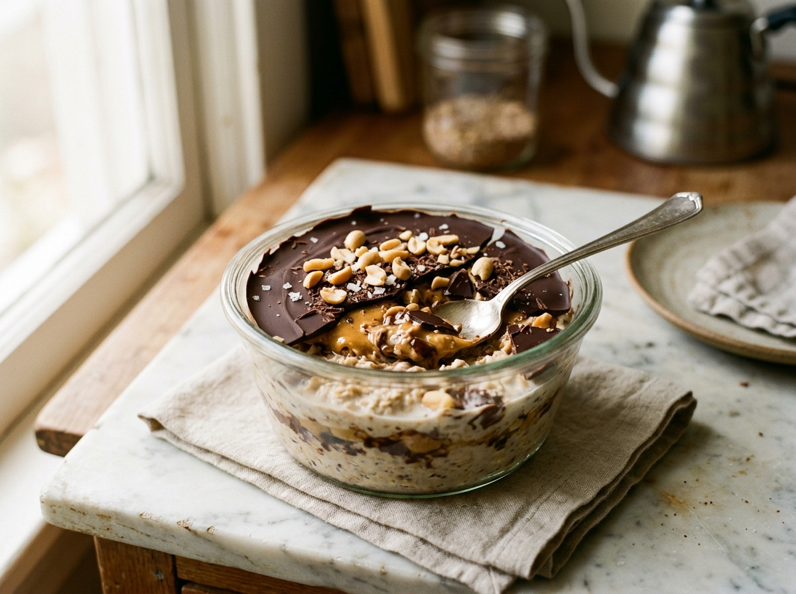 `images/snickers_oats.jpg`
* **Autora / Origen:** Erth & Me (@erth.and.me).
* **Calorías & Macros:** ~440 kcal · 38g Proteína · 42g Carbohidratos limpios · 12g Grasas saludables.
* **Ingredientes del Mercadona:**
  * 50 g de copos o harina de avena certificada Sin Gluten.
  * 25–30 g de proteína AMIX CFM Isolate (vainilla o neutra).
  * 100 g de yogur griego natural sin azúcar.
  * 5 g de semillas de lino o chía molidas.
  * 10 g de crema de cacahuete 100% (o cacahuete en polvo).
  * 80–90 ml de bebida de avena sin azúcares o agua.
  * *Capa de caramelo express:* 1 cdita de crema de cacahuete + 1 cdita de sirope de arce o chorrito de miel cruda.
  * *Capa crujiente:* 15–20 g de chocolate negro >85% derretido.
* **Elaboración:** Mezclar la avena, proteína, yogur, chía y bebida vegetal en un vaso o ramequín. Dejar reposar 1 hora en la nevera. Untar la capa de crema de cacahuete por encima. Fundir el chocolate negro al microondas en tandas de 20 seg y verterlo sobre la superficie formando una lámina uniforme. Dejar enfriar toda la noche en la nevera. Por la mañana, romper la capa de chocolate crujiente con la cuchara.
* **Efecto Clínico:** Sabor dulce tipo chocolatina con cero picos de insulina; la fibra de avena y chía lubrica el colon y el magnesio del chocolate negro relaja el sistema nervioso.

---

### 2. Arepas Doradas de Maíz P.A.N. con Revuelto Campero y Cottage
* **Foto:** 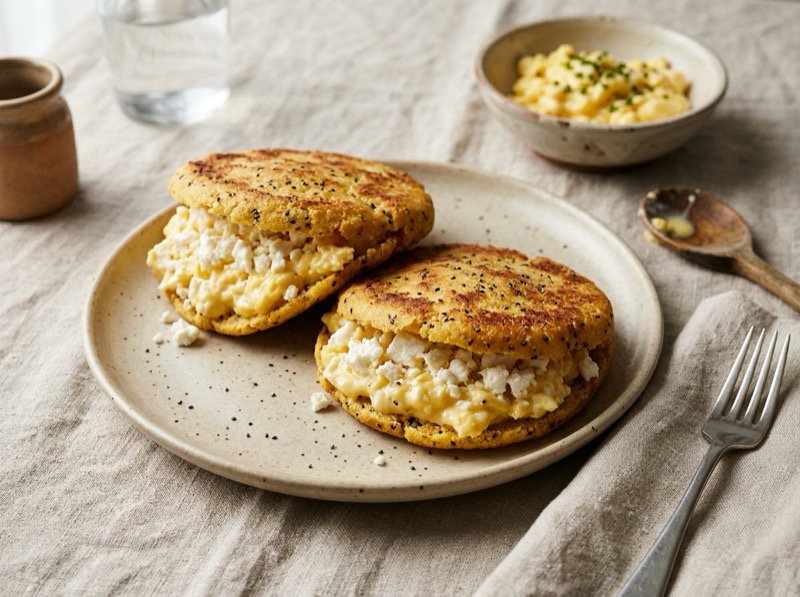 `images/arepas_pan.jpg`
* **Autora / Origen:** Receta tradicional adaptada antiinflamatoria.
* **Calorías & Macros:** ~430 kcal · 42g Proteína · 38g Carbohidratos limpios · 12g Grasas.
* **Ingredientes del Mercadona:**
  * 45 g de harina de maíz precocida P.A.N. blanca o amarilla.
  * 1 cdita de semillas de chía previamente hidratadas en 3 cdas de agua templada.
  * 1 huevo campero entero + 2 claras pasteurizadas Hacendado.
  * 2 cucharadas colmadas (40 g) de queso cottage Hacendado.
  * Pizca de sal marina y chorrito de AOVE virgen extra.
* **Elaboración:** Hidratar la chía 5 minutos hasta formar un gel. Mezclar con la harina P.A.N., agua templada y sal hasta formar una masa suave. Moldear la arepa y dorarla en sartén 5 min por lado hasta que quede crujiente por fuera y tierna por dentro. En otra sartén, hacer el revuelto jugoso de huevo y claras. Abrir la arepa y rellenar con el revuelto caliente y el queso cottage fresco.
* **Efecto Clínico:** Los mucílagos de la chía protegen la mucosa estomacal; la proteína del huevo y cottage asegura 4 horas de saciedad sin hinchazón.

---

### 3. Batch Pancakes Esponjosos de Avena & AMIX CFM con Manzana Tibia
* **Foto:** 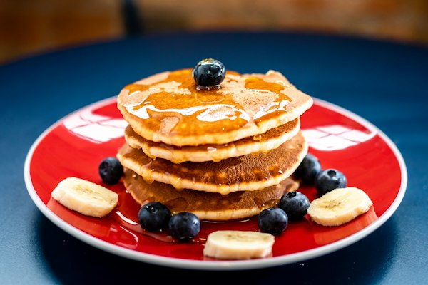 `images/pancakes_avena.jpg`
* **Autora / Origen:** Fórmula propia de Batch Cooking de alto rendimiento.
* **Calorías & Macros:** ~420 kcal · 40g Proteína · 44g Carbohidratos limpios · 9g Grasas.
* **Ingredientes del Mercadona:**
  * 50 g de harina de avena certificada Sin Gluten.
  * 25 g de proteína AMIX CFM Isolate.
  * 1 huevo campero + 2 claras.
  * 60–80 ml de bebida de avena sin azúcares.
  * 1 cdita de levadura química sin gluten y canela de Ceilán.
  * 1/2 manzana dulce cortada en láminas finas y salteada 1 min con canela.
* **Elaboración:** Batir todos los ingredientes de la masa hasta que quede homogénea y espesa. Verter en sartén antiadherente caliente en porciones pequeñas. Cuando salgan burbujas en la superficie, dar la vuelta y dorar 1 minuto más. Servir con la manzana templada por encima.
* **Efecto Clínico:** Aporte sostenido de carbohidratos complejos de bajo índice glucémico y proteína de suero aislada sin lactosa pesada.

---

### 4. Warm Jammy Pears con Cardamomo & Yogur Griego Cremoso
* **Foto:** 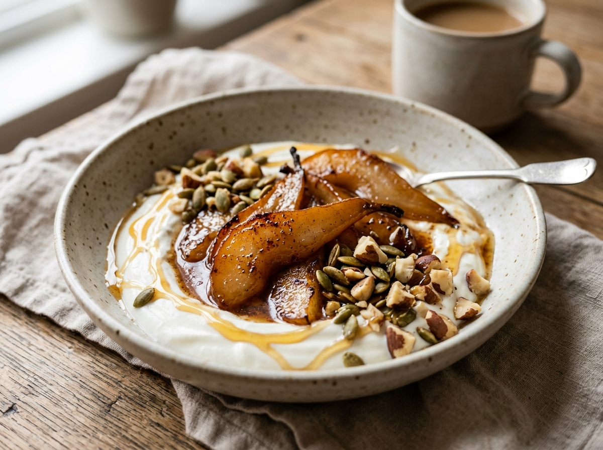 `images/peras_cardamomo.jpg`
* **Autora / Origen:** Raquel Martin (Raquel's Pantry / *Pass the Salt*).
* **Calorías & Macros:** ~410 kcal · 32g Proteína · 44g Carbohidratos · 11g Grasas.
* **Ingredientes del Mercadona:**
  * 2 peras conferencia o de agua maduras peladas y troceadas.
  * 1 cda de zumo de limón Hacendado.
  * 1/2 cdita de cardamomo molido y 1 rama de canela.
  * 150 g de yogur griego natural sin azúcar (o queso cottage batido).
  * 1 cdita de semillas de chía o pipas de calabaza tostadas.
* **Elaboración:** Cocinar las peras en un cazo con el zumo de limón, cardamomo y 2 cucharadas de agua a fuego suave durante 8 minutos hasta que se caramelicen y queden melosas. Servir calientes sobre una base de yogur griego frío y espolvorear semillas crujientes.
* **Efecto Clínico:** El cardamomo estimula la secreción de enzimas biliares e inhibe los espasmos gástricos; la pectina cocida de la pera es el alimento predilecto de las bifidobacterias intestinales.

---

### 5. Waffles Esponjosos de Avena y Claras con Frutos Rojos Templados
* **Foto:** 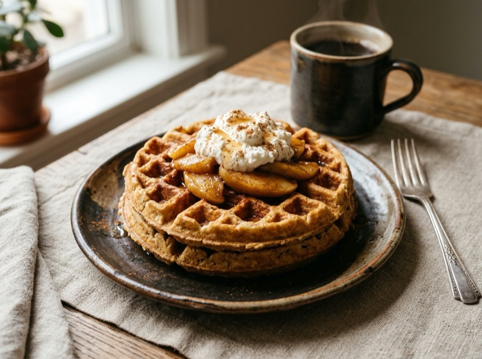 `images/waffles_avena.jpg`
* **Autora / Origen:** Adaptación de desayuno saciante de fin de semana.
* **Calorías & Macros:** ~425 kcal · 36g Proteína · 44g Carbohidratos · 11g Grasas.
* **Ingredientes:** 45 g de harina de avena sin gluten, 1 huevo + 3 claras, 20 g de proteína en polvo, 50 ml de bebida de avena, 1 taza de frutos rojos congelados descongelados en microondas.
* **Elaboración:** Mezclar la masa y verter en gofrera caliente engrasada con una gota de AOVE. Dejar dorar 4 minutos. Coronar con los frutos rojos calientes que soltarán su almíbar natural.
* **Efecto Clínico:** Ricos en antocianinas y polifenoles antiinflamatorios que reducen el estrés oxidativo.

---

### 6. Crepes Esponjosos de Avena con Frutos Rojos (Pre-Entreno Barre)
* **Foto:**  `images/crepes_dulces.jpg`
* **Autora / Origen:** Menú sábado pre-entreno O2 Boutique.
* **Calorías & Macros:** ~380 kcal · 28g Proteína · 42g Carbohidratos · 8g Grasas.
* **Ingredientes:** 40 g harina de avena sin gluten, 1 huevo + 1 clara, 1/2 cazo proteína AMIX CFM, 90 ml bebida de avena, pizca de sal.
* **Elaboración:** Masa más líquida que los pancakes. Verter una capa fina en sartén amplia caliente, voltear a los 90 segundos y doblar en abanico con frutos rojos y canela.

---

## 🥗 SECCIÓN 2: ALMUERZOS ANTIINFLAMATORIOS & MODULARES

### 7. Solomillitos de Pavo al Limón y Romero con Boniato Asado
* **Foto:** 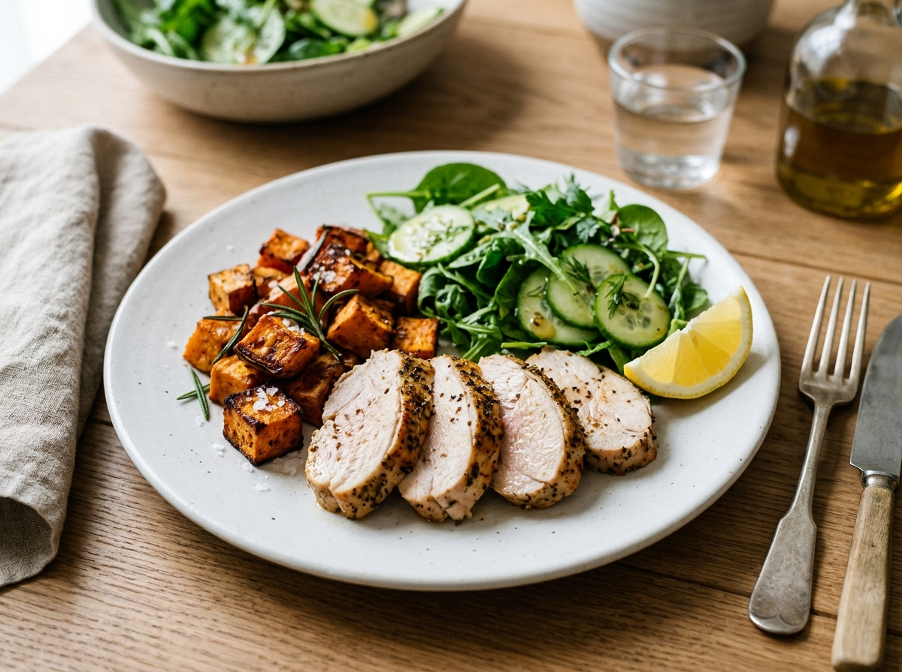 `images/pavo_asado.jpg`
* **Autora / Origen:** AJ Foodie (@ajfoodie).
* **Calorías & Macros:** ~430 kcal · 44g Proteína · 38g Carbohidratos limpios · 9g Grasas.
* **Ingredientes del Mercadona:**
  * 160 g de solomillo de pavo o pechuga de pollo fresca en filetes gruesos.
  * Zumo de 1/2 limón en botella Hacendado.
  * Romero seco, orégano, ajo en polvo y sal marina.
  * 150 g de boniato asado en dados (del batch cooking).
  * 1 taza de canónigos frescos y tomates cherry aliñados con 1 cdita de AOVE.
* **Elaboración:** Marinar el pavo 5 minutos con el limón, romero, ajo y sal. Dorar en sartén con unas gotas de AOVE a fuego vivo 3 minutos por lado hasta que quede sellado y muy tierno. Calentar los dados de boniato en la misma sartén 1 minuto para que tomen los jugos del limón y servir junto a los canónigos frescos.
* **Efecto Clínico:** El pavo aporta triptófano (precursor de serotonina y melatonina) y tirosina (aminoácido fundamental para la hormona tiroidea T4). El boniato aporta almidón resistente que nutre la pared intestinal.

---

### 8. Mediterranean Quinoa Crunch Bowl con Pollo y Salsa Lemon-Tahini
* **Foto:** 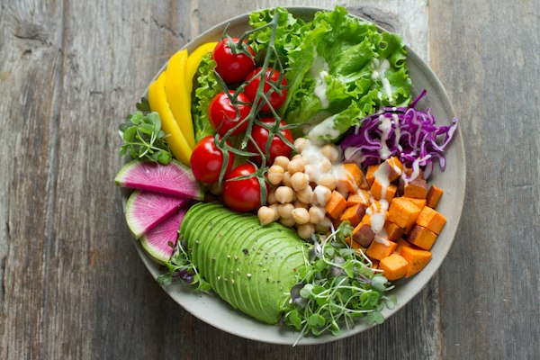 `images/quinoa_bowl.jpg`
* **Autora / Origen:** Annabelle Cassidy & Tom Eterovic (*The Anti-Inflammatory Club*).
* **Calorías & Macros:** ~440 kcal · 42g Proteína · 40g Carbohidratos · 12g Grasas.
* **Ingredientes del Mercadona:**
  * 150 g de pechuga de pollo marinada con orégano y limón.
  * 70 g de quinoa cocida con cúrcuma y sal marina.
  * 1 taza de tomates cherry dulces cortados y dados de calabacín salteados 2 minutos.
  * *Salsa Lemon-Tahini:* 1 cda de tahini blanco + zumo de 1/2 limón + 1 cda de agua fría batido enérgicamente con tenedor hasta que emulsione blanco y sedoso.
* **Elaboración:** Montar el bowl colocando en la base la quinoa templada. Añadir el pollo cortado en bocados y las verduras al dente. Bañar con la salsa cremosa de tahini y limón.
* **Efecto Clínico:** El tahini es una de las mayores fuentes vegetales de calcio biodisponible; la cúrcuma desinflama el epitelio digestivo y el limón previene la fermentación gástrica.

---

### 9. Hamburguesa Casera de Ternera con Queso Havarti y Ensalada Crunch
* **Foto:** 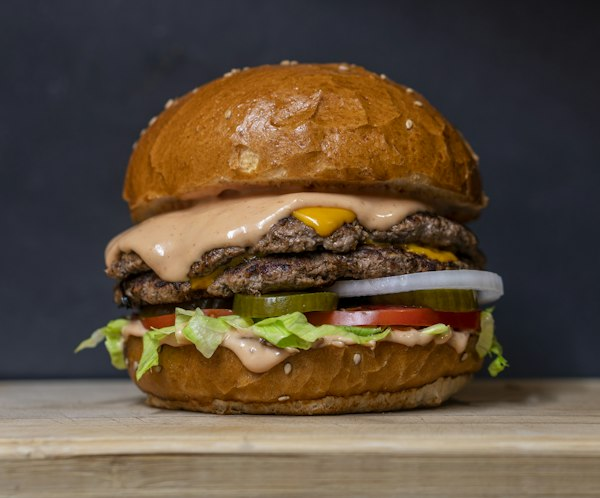 `images/hamburguesa.jpg`
* **Autora / Origen:** Receta de carne magra limpia sin panes brioche con gluten.
* **Calorías & Macros:** ~460 kcal · 42g Proteína · 32g Carbohidratos · 18g Grasas.
* **Ingredientes del Mercadona:**
  * 1 hamburguesa de vacuno limpia o 140 g de carne picada limpia de ternera.
  * 1 loncha de queso havarti o tierno light.
  * 2 tortitas de maíz 100% sin gluten (Old El Paso o Hacendado) tostadas crujientes.
  * Canónigos frescos, rodajas de tomate y mostaza de Dijon pura (sin azúcares).
* **Elaboración:** Cocinar la hamburguesa en sartén bien caliente 2–3 minutos por lado. Apagar el fuego y colocar la loncha de queso havarti encima para que se funda con el calor residual. Tostar las tortitas de maíz en la tostadora o sartén y servir como acompañamiento crujiente con la ensalada fresca.
* **Efecto Clínico:** Hierro hemo de máxima absorción y zinc esencial para la función ovárica y tiroidea. Libre al 100% de gluten y harinas inflamatorias.

---

### 10. Sartenada Express de Garbanzos con Ternera y Espinacas a la Cúrcuma
* **Foto:** 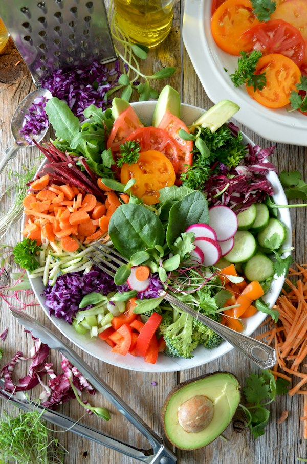 `images/garbanzos_gambas.jpg`
* **Autora / Origen:** Receta clínica de legumbre limpia anti-gases.
* **Calorías & Macros:** ~480 kcal · 40g Proteína · 38g Carbohidratos · 14g Grasas.
* **Ingredientes:** 150 g de garbanzos cocidos en tarro (enjuagados 30 seg bajo el grifo para eliminar la saponina indigesta), 140 g de tiras de ternera magra, espinacas tiernas, ajo en polvo, cúrcuma y AOVE.
* **Elaboración:** Dorar la ternera 2 min. Añadir los garbanzos limpios y las espinacas con cúrcuma. Saltear 3 min a fuego vivo hasta que las espinacas colapsen.
* **Efecto Clínico:** Al enjuagar a fondo el bote de legumbre, se elimina el 90% de los oligosacáridos que causan gases; la fibra soluble combate eficazmente el estreñimiento crónico.

---

### 11. Wok Rápido de Tiras de Ternera con Calabacín y Arroz Basmati
* **Foto:** 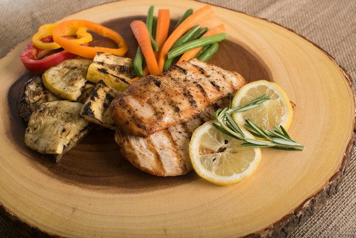 `images/pollo_arroz.jpg`
* **Autora / Origen:** AJ Foodie (@ajfoodie).
* **Calorías & Macros:** ~450 kcal · 42g Proteína · 44g Carbohidratos · 11g Grasas.
* **Ingredientes:** 150 g de ternera magra en tiras, 1 calabacín verde en medias lunas, 1 vasito de arroz basmati cocido al punto, 1 cdita de tamari (soja sin gluten), AOVE.
* **Elaboración:** Saltear la ternera 2 min a fuego muy fuerte, añadir el calabacín para que quede al dente y el arroz basmati. Sazonar con un toque de tamari y servir humeante.

---

### 12. Pastelitos Dorados de Salmón y Boniato (Fishcakes de Annabelle & Tom)
* **Foto:** 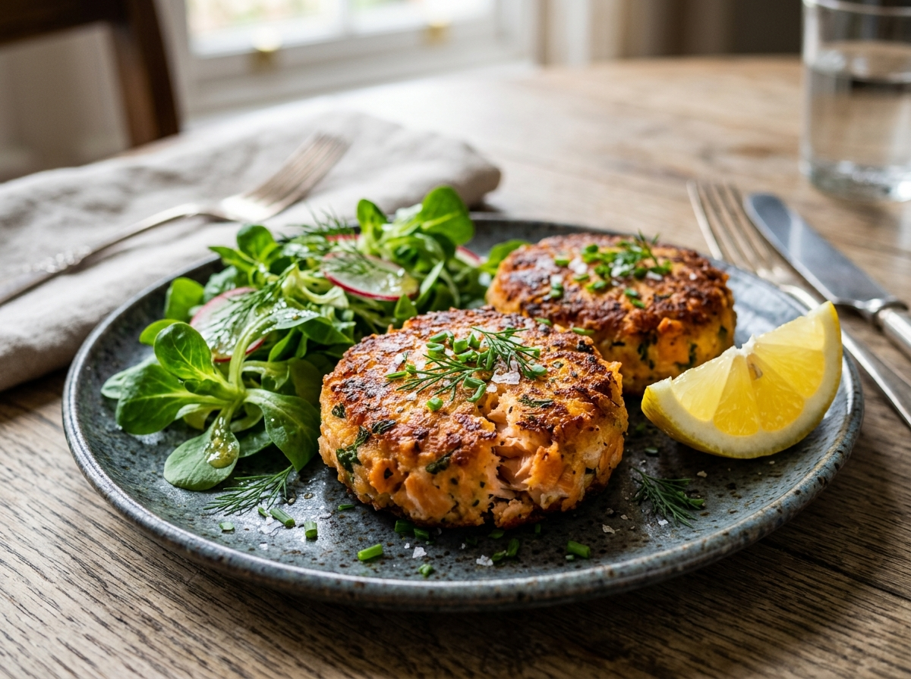 `images/fishcakes_salmon.jpg`
* **Autora / Origen:** Annabelle Cassidy (*The Anti-Inflammatory Club*).
* **Calorías & Macros:** ~440 kcal · 36g Proteína · 38g Carbohidratos · 16g Grasas.
* **Ingredientes:** 1 lomo de salmón fresco desmigado (sin piel), 1 boniato asado chafado con tenedor, cebollino fresco picado, ralladura de limón, 1 huevo campero.
* **Elaboración:** Mezclar el salmón desmigado con el boniato chafado, el huevo y el cebollino. Formar medallones y dorar en sartén con AOVE 3–4 minutos por lado hasta que queden crujientes y dorados.

---

### 13. Sartenada de Cintas de Calabacín con Gambas al Ajillo y Lima
* **Foto:** 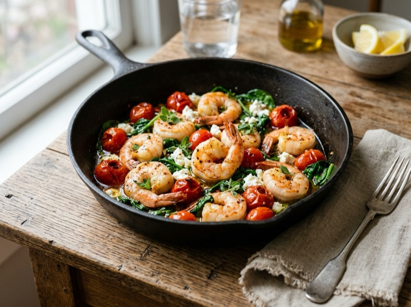 `images/camarones_cherrys.jpg`
* **Autora / Origen:** Raquel Martin (@raquels.pantry).
* **Calorías & Macros:** ~410 kcal · 38g Proteína · 32g Carbohidratos · 12g Grasas.
* **Ingredientes:** 150 g de colas de gambas peladas Hacendado, 2 calabacines cortados en cintas finas con el pelador de patatas, 1 diente de ajo laminado, zumo de lima, copos de chile suave opcionales, AOVE.
* **Elaboración:** Dorar el ajo con AOVE, saltear las gambas 2 minutos, añadir las cintas de calabacín sólo 60 segundos para mantener el crujido. Terminar con zumo de lima fresco.

---

### 14. Lomo de Salmón a la Plancha con Piel Crujiente y Boniato
* **Foto:** 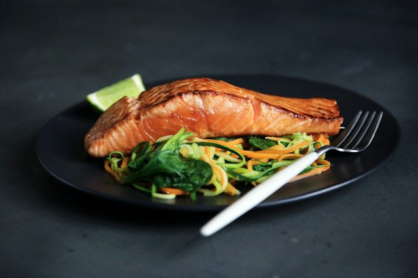 `images/salmon_plancha.jpg`
* **Calorías & Macros:** ~460 kcal · 38g Proteína · 32g Carbohidratos · 20g Grasas.
* **Ingredientes:** 1 lomo de salmón fresco con piel, dados de boniato asado, canónigos y aceite de oliva virgen extra.
* **Elaboración:** Marcar primero el salmón por el lado de la piel durante 4 minutos a fuego medio hasta que quede crujiente. Dar la vuelta solo 1 minuto para mantener el corazón jugoso.

---

## 🍫 SECCIÓN 3: MERIENDAS SALUDABLES & DOPAMINA

### 15. Fruit, Nut & Seed Dark Chocolate Bark
* **Foto:** 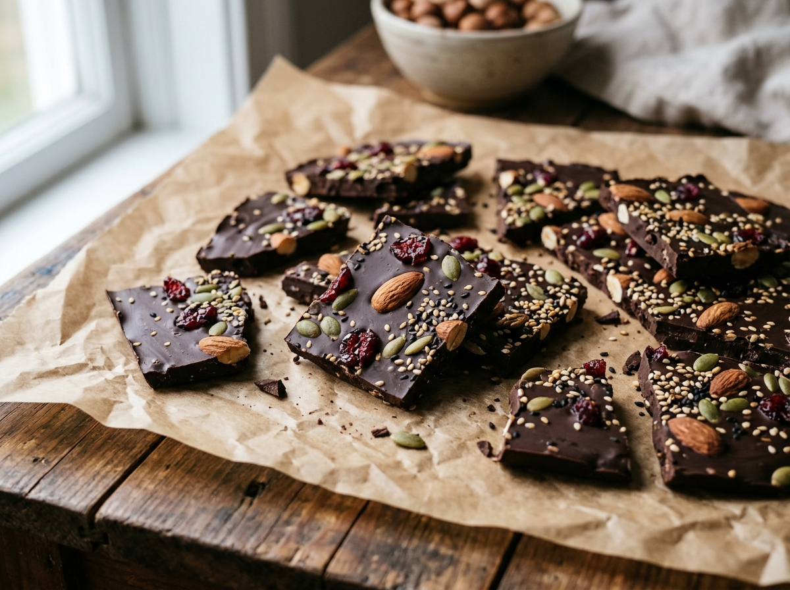 `images/chocolate_bark.jpg`
* **Autora / Origen:** Emily on Toast (Substack: *emilyontoast.substack.com*).
* **Calorías & Macros:** ~220 kcal · 6g Proteína · 18g Carbohidratos · 14g Grasas.
* **Ingredientes:** 25 g de chocolate negro >85% fundido, 1 cdita de semillas de chía, 1 cdita de pipas de calabaza tostadas, 1 nuez de Brasil troceada, arándanos deshidratados o frutos rojos, escamas de sal marina.
* **Elaboración:** Fundir el chocolate negro, extenderlo sobre papel vegetal en una placa fina, esparcir las semillas, frutos secos y la pizca de sal en escamas. Enfriar 20 min en congelador hasta solidificar. Partir en trozos rústicos ("bark").
* **Efecto Clínico:** Altísimo contenido en polifenoles, zinc y magnesio para mitigar el dolor menstrual y calmar el deseo de azúcar sin alterar la glucemia.

---

### 16. Mousse Cremosa de Chocolate Belga & AMIX CFM Isolate
* **Foto:**  `images/mousse_chocolate.jpg`
* **Autora / Origen:** Protocolo de saciedad dulce y aporte proteico limpio.
* **Calorías & Macros:** ~240 kcal · 26g Proteína · 16g Carbohidratos · 7g Grasas.
* **Ingredientes:** 1 yogur griego natural sin azúcar, 20 g de proteína AMIX CFM Isolate de chocolate o vainilla, 1 cucharada de cacao puro desgrasado 100%, 1 nuez de Brasil picada por encima.
* **Elaboración:** Batir enérgicamente el yogur griego con la proteína y el cacao en un cuenco con una cuchara o varilla pequeña durante 60 segundos hasta que emulsione y quede una textura densa, aireada y brillante. Servir fría con la nuez de Brasil troceada.
* **Efecto Clínico:** Satisface el antojo de chocolate de forma inmediata con 26 g de proteína limpia que eleva los niveles de dopamina y serotonina.

---

### 17. Yogur Griego con Frutos Rojos Calientes y Nueces de Brasil
* **Foto:** 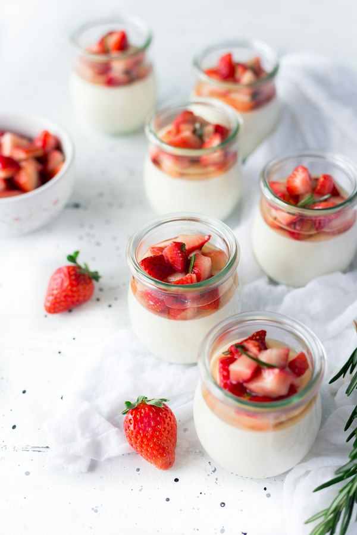 `images/yogur_frutos_rojos.jpg`
* **Calorías & Macros:** ~230 kcal · 18g Proteína · 20g Carbohidratos · 9g Grasas.
* **Ingredientes:** 1 tarrina de yogur griego ligero, 1 taza de frutos rojos congelados Hacendado, 2 nueces de Brasil (dosis exacta de 100 mcg de selenio orgánico), canela de Ceilán.
* **Elaboración:** Calentar los frutos rojos en una taza al microondas 45 segundos hasta que se templen y liberen su jugo carmesí natural. Verter caliente sobre el yogur frío y coronar con las nueces de Brasil en láminas.
* **Efecto Clínico:** El selenio es el cofactor indispensable de la enzima desyodasa que transforma la T4 en T3 en el hígado e intestino.

---

### 18. Golden Cocoa Caliente Anti-Cólicos con Cúrcuma y Canela
* **Foto:**  `images/golden_cocoa.jpg`
* **Calorías & Macros:** ~180 kcal · 5g Proteína · 22g Carbohidratos · 6g Grasas.
* **Ingredientes:** 250 ml de bebida de avena sin azúcares caliente, 1 cdita de cacao puro 100%, 1/2 cdita de cúrcuma en polvo, 1/2 cdita de canela de Ceilán, pizca diminuta de pimienta negra (multiplica por 20 la absorción de curcumina).
* **Elaboración:** Calentar la bebida vegetal y batir con espumador de leche hasta crear una espuma densa y dorada.
* **Efecto Clínico:** Potente vasodilatador y relajante uterino natural para los días de tensión por el DIU.

---

### 19. Manzana Asada con Canela de Ceilán y Chocolate Negro
* **Foto:** 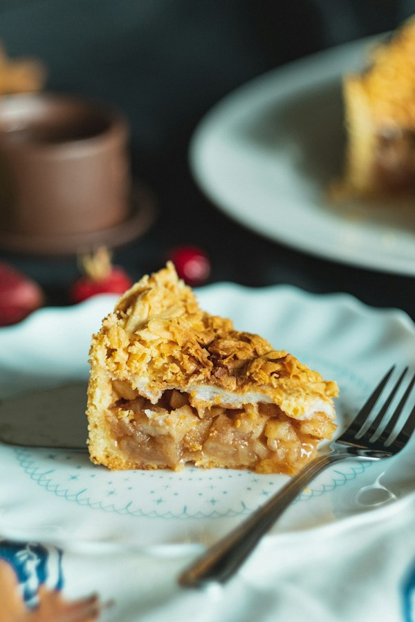 `images/manzana_asada.jpg`
* **Calorías & Macros:** ~210 kcal · 4g Proteína · 34g Carbohidratos · 7g Grasas.
* **Ingredientes:** 1 manzana Golden descorazonada, 1 cdita de canela de Ceilán, 1 onza de chocolate negro >85% introducida en el centro antes de hornear.
* **Elaboración:** Asar al microondas 4 min o en horno 20 min hasta que quede tierna y caramelizada.

---

## 🍲 SECCIÓN 4: CENAS DIGESTIVAS ANTI-HINCHAZÓN

### 20. Shakshuka Suave de Tomates Dulces y Huevos Camperos con Maíz
* **Foto:** 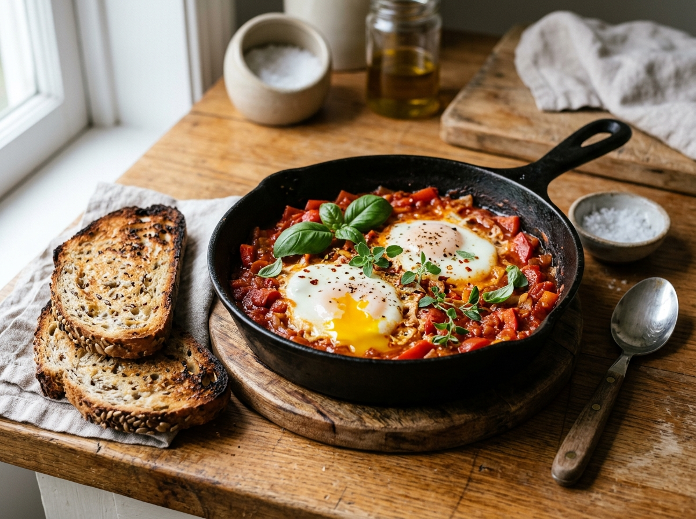 `images/shakshuka_huevos.jpg`
* **Autora / Origen:** Mona Naudts (@mona.naudts).
* **Calorías & Macros:** ~390 kcal · 26g Proteína · 32g Carbohidratos · 15g Grasas.
* **Ingredientes del Mercadona:**
  * 2 huevos camperos frescos (o 1 huevo + 2 claras).
  * 1/2 lata de tomate troceado o triturado natural sin azúcares añadidos.
  * 1/2 calabacín en dados pequeños y 1/4 cebolla pochada en AOVE.
  * Comino molido, pimentón dulce de la Vera, orégano y sal marina.
  * 2 tortitas de maíz 100% sin gluten tostadas para mojar en la yema.
* **Elaboración:** Pochar el calabacín y cebolla 3 min en sartén con AOVE. Añadir el tomate triturado y las especias digestivas; dejar reducir 5 minutos a fuego medio hasta tener una salsa espesa y aromática. Hacer dos huecos con la cuchara, cascar los huevos dentro, tapar la sartén y cocinar a fuego bajo 3–4 minutos hasta que la clara cuaje pero la yema quede líquida. Servir directamente en la sartén con las tortitas de maíz crujientes.
* **Efecto Clínico:** El licopeno cocinado del tomate es un antiinflamatorio sistémico; la colina del huevo nutre las membranas celulares y el comino previene flatulencias.

---

### 21. Crema Dorada de Calabaza, Puerro y Cúrcuma con Huevo Poché
* **Foto:** 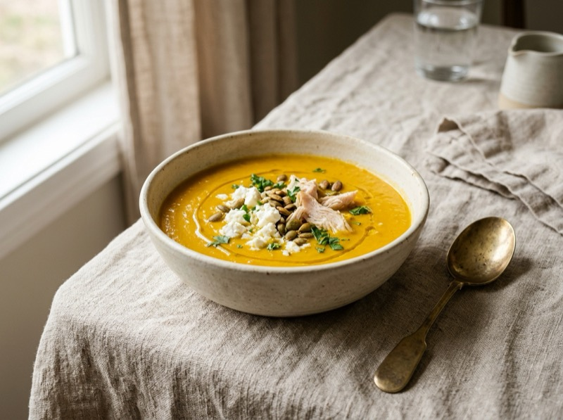 `images/crema_calabaza.jpg`
* **Autora / Origen:** Receta maestra de Batch Cooking desinflamante.
* **Calorías & Macros:** ~380 kcal · 28g Proteína · 32g Carbohidratos · 14g Grasas.
* **Ingredientes:**
  * 1 ración generosa (350 ml) de crema dorada de calabaza, puerro, zanahoria y cúrcuma.
  * 1 huevo campero poché (cocinado 3 min en agua hirviendo con chorrito de vinagre).
  * 1 cazo de proteína Moara / caldo de huesos / queso cottage deshecho en la crema caliente.
  * Semillas de calabaza tostadas crujientes por encima y chorrito de AOVE virgen extra en crudo.
* **Elaboración:** Calentar la crema de calabaza, verter en cuenco hondo y colocar en el centro el huevo poché recién hecho. Romper la yema para que se mezcle con la textura sedosa de la crema.
* **Efecto Clínico:** Digestión ultrarrápida sin esfuerzo gástrico antes de dormir; calor relajante para la zona pélvica.

---

### 22. Fajitas de Pollo o Ternera en Tortitas de Maíz 100% con Guacamole Express
* **Foto:** 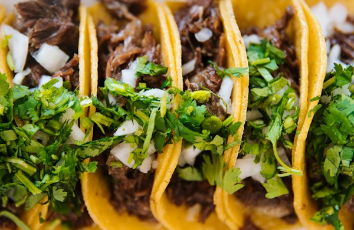 `images/fajitas_pollo.jpg`
* **Calorías & Macros:** ~460 kcal · 38g Proteína · 30g Carbohidratos · 14g Grasas.
* **Ingredientes:** 150 g de pechuga de pollo o ternera en tiras finas, pimientos y calabacín en juliana, 2 tortillas de maíz 100% sin gluten, 2 cdas de queso cottage cremoso o 1/4 aguacate triturado con lima.
* **Elaboración:** Saltear la carne y verduras con orégano y pimentón 4 min a fuego vivo. Rellenar las tortillas calientes.

---

### 23. Pollo al Curry Suave y Leche de Coco Ligera con Quinoa
* **Foto:** 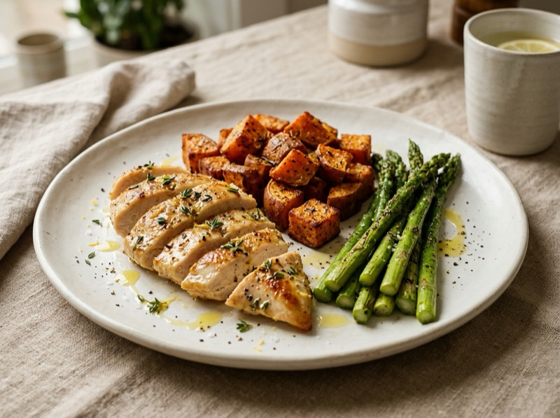 `images/pollo_boniato.jpg`
* **Autora / Origen:** Nutri Aconséjame (@nutriaconsejame).
* **Calorías & Macros:** ~420 kcal · 42g Proteína · 34g Carbohidratos · 12g Grasas.
* **Ingredientes:** 160 g de pollo en dados, 3 cdas de leche de coco ligera, 1 cdita de curry suave, 60 g de quinoa cocida, dados de calabacín.

---

## 🍱 SECCIÓN 5: PREPARACIONES BASE PARA BATCH COOKING SEMANAL

*(Preparar el domingo o lunes en 60 minutos para tener resuelta toda la semana con cero estrés)*

1. **Torre de Pancakes AMIX CFM (6 a 8 unidades):** Se conservan en táper hermético en la nevera hasta 5 días. Se calientan 30 segundos en la tostadora.
2. **Olla de Crema Dorada (Calabaza + Puerro + Zanahorias + Cúrcuma):** 4 a 5 raciones listas para triturar y calentar en 2 minutos como cena ligera o base de comidas.
3. **Bandeja de Batatas Asadas al Romero:** 2 piezas grandes en cubos asadas 30 min a 200°C. Carbohidrato limpio listo para acompañar pavo, pollo o salmón.
4. **Arepas Precocidas de Maíz P.A.N. con Chía:** Se marcan 3 min en sartén y se guardan precocinadas. Cada mañana se terminan de tostar 2 minutos en sartén o tostadora.
5. **Pollo o Salmón Marinado en Limón y Hierbas:** Filetes limpios en táper con limón, AOVE y romero para pasar por la plancha caliente en 4 minutos.

---

*Compilado y verificado para el sistema de nutrición y fitness de Florencia Schmidt · 100% Conexiones fotográficas validadas en `images/`.*
