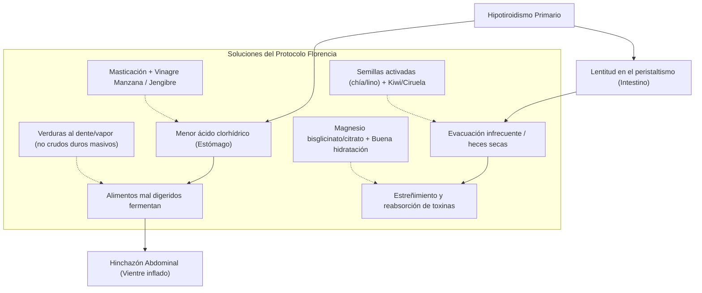

# GUÍA MAESTRA DE REFERENTES, RECETAS ANTIINFLAMATORIAS & PROTOCOLO DIGESTIVO-MOTIVACIONAL

**Atleta:** Florencia  
**Áreas:** Hipotiroidismo, Salud Hormonal Femenina, Ciclo Menstrual, Digestión & Microbiota, Recetas Antiinflamatorias Modulares  

---

## 1. CUADRO DE HONOR DE EXPERTOS Y REFERENTES CIENTÍFICOS

Hemos seleccionado a las máximas autoridades internacionales y de habla hispana que abordan la tiroides, las hormonas femeninas y la salud digestiva desde la raíz inmunometabólica:

### A. Eje Tiroides, Inflamación y Microbiota (La Raíz Clínica)
1. **Dra. Gabriela Pocoví Gerardino (@gabrielapocovi_nutricion)**  
   * *Perfil:* Doctora en Medicina y Salud Pública, Dietista-Nutricionista, especialista en inmunonutrición y autoinmunidad. Autora de *El método antiinflamatorio* y *La solución para la inflamación*.  
   * *Aporte clave para Florencia:* Explicación del **eje intestino-hígado-tiroides**. El 20% de la conversión de T4 (inactiva, como Eutirox) a T3 (activa, metabólica) se da en el intestino gracias a una microbiota sana; si hay inflamación o disbiosis, hay menos T3, más lentitud metabólica, más gases y estreñimiento.
2. **Dra. Izabella Wentz, PharmD (@izabellawentzpharmd)**  
   * *Perfil:* Farmacéutica clínica y máxima referente mundial en Hashimoto e hipotiroidismo. Autora de *Hashimoto's Protocol* y *Adrenal Transformation Protocol*.  
   * *Aporte clave para Florencia:* Protocolos para resolver la hipoclorhidria (falta de ácido estomacal en hipotiroidismo que provoca hinchazón tras comer), optimización del selenio orgánico, tiamina (vitamina B1) para la fatiga aplastante y manejo del estreñimiento refractario.
3. **Dra. Sari Arponen (@drasariarponen)**  
   * *Perfil:* Doctora en Medicina, especialista en Medicina Interna y experta en microbiota. Autora de *¡Es la microbiota, idiota!* y *El sistema inmunitario sale del armario*.  
   * *Aporte clave para Florencia:* Regulación de la barrera intestinal, modulación del agua extracelular (drenaje de retención líquida) y control de la inflamación subclínica.
4. **Dra. Isabel Viña Bas (@isabelvibas)**  
   * *Perfil:* Médico divulgadora en endocrinología integrativa, metabolismo, tiroides y salud de la mujer.  
   * *Aporte clave para Florencia:* Estrategias para combatir la niebla mental y la falta de dopamina/motivación vinculadas a la hipofunción tiroidea, así como el timing circadiano de la levotiroxina y el magnesio.

### B. Salud Hormonal Femenina, Ciclo Menstrual y DIU
1. **Alisa Vitti (@floliving)**  
   * *Perfil:* Nutricionista funcional integrativa, fundadora de FLO Living y pionera del concepto *Cycle Syncing®*. Autora de *WomanCode* e *In the FLO*.  
   * *Aporte clave para Florencia:* Sincronización de los macronutrientes y las cargas de ejercicio según las fases hormonales, optimizando la quema de grasa en fase folicular sin agotar los adrenales en la lútea.
2. **Dr. Jolene Brighten, ND (@drjolenebrighten)**  
   * *Perfil:* Médico naturópata y endocrinóloga funcional femenina. Autora de *Beyond the Pill* y *Is This Normal?*.  
   * *Aporte clave para Florencia:* Manejo de la progestina del DIU Kyleena a nivel local, detoxificación hepática de estrógenos y alivio de cólicos/tensión pélvica mediante magnesio, calor y micronutrición.
3. **Dr. Aviva Romm, MD (@dr.avivaromm)**  
   * *Perfil:* Médico obstetra/ginecóloga formada en Yale y herborista clínica. Autora de *Hormone Intelligence* y *The Adrenal Thyroid Revolution*.  
   * *Aporte clave para Florencia:* El triángulo adrenales-tiroides-ovarios: cómo el estrés y el cortisol bloquean los receptores tiroideos e impiden la recomposición corporal.
4. **Marta León (@foodgreenmood)**  
   * *Perfil:* Ingeniera química especializada en alimentación y salud hormonal femenina. Autora de *Alimentación y salud femenina*.  
   * *Aporte clave para Florencia:* Alimentos botánicos y recetas antiinflamatorias específicas para nutrir el endometrio y la fase folicular/lútea.
5. **Blanca García-Orea Haro (@blancanutri)**  
   * *Perfil:* Nutricionista clínica especializada en aparato digestivo y microbiota. Autora de *Dime qué comes y te diré qué bacterias tienes*.  
   * *Aporte clave para Florencia:* Protocolos inmediatos para el vientre hinchado (meteorismo) y recetas prácticas para el estreñimiento crónico.

---

## 2. CANALES Y BLOGS DE RECETAS PARA INSPIRARNOS Y REPLICAR

Buscamos creadoras que compartan platos **visualmente irresistibles, rápidos, antiinflamatorios y 100% compatibles** con las pautas de Florencia (libres de gluten, sin pescados blancos, con salmón/atún/camarones, aves, huevos, lácteos seleccionados y aderezos emulsionados):

| Creadora / Canal | Plataforma / Enlace | Estilo Gastronómico y Por Qué Nos Sirve |
| :--- | :--- | :--- |
| **Annabelle Cassidy & Tom Eterovic** | Substack: *The Anti-Inflammatory Club* / IG: `@annabelle_cassidy` | **Nuestra referencia número 1.** Cocina modular, ensaladas crujientes con granos limpios, aderezos de tahini, limón y yogur, y sartenadas de cena en 10 minutos. Específicamente diseñadas para deshinchar el vientre. |
| **Mia Rigden** | Substack: *The Well Journal* / IG: `@miarigden` | Nutricionista de Los Ángeles. Especialista en "The Modular Meal System": bowls con bases de verduras asadas, quinoa/arroz, salmón o pollo marinado con hierbas frescas. |
| **Carissa Stanton (Brocc Your Body)** | IG / Blog: `@broccyourbody` | Creadora de platos hiperfáciles (<20 min) llenos de color y sabor: bowls de camarones salteados con lima y ajo, lomos de salmón glaseados, ensaladas templadas con feta y vinagretas caseras. Muy adaptable a sin gluten. |
| **Paula Monreal (Paufeel)** | IG: `@paufeel` | Referente en España de cocina 100% sin gluten, antiinflamatoria y ultra digestiva. Famosa por sus sartenadas express de cena (huevos con cherrys, tortillas esponjosas, pancakes salados de calabacín y atún). |
| **Elena y María (Futurlife21)** | IG: `@futurlife21` | Bioquímicas y nutricionistas. Expertas en batch cooking antiinflamatorio para la semana, con preparaciones ricas en fibra soluble para combatir el estreñimiento sin generar gases. |
| **Alex Snodgrass (The Defined Dish)** | Blog / IG: `@thedefineddish` | Autora superventas de cocina libre de gluten y antiinflamatoria. Sus marinados para pechuga de pollo y salsas satay de cacahuete con tamari son perfectas para comidas compartidas en pareja. |

---

## 3. PROTOCOLO CLÍNICO: COMBATIR LA HINCHAZÓN Y EL ESTREÑIMIENTO

El hipotiroidismo primario disminuye el metabolismo celular global. Esto causa directamente:
1. **Hipoclorhidria:** El estómago produce menos ácido clorhídrico, provocando digestiones lentas y fermentación de los alimentos en el intestino alto (**hinchazón / sensación de "globo" tras comer**).
2. **Tránsito Intestinal Lento:** La hormona tiroidea T3 es el "motor" del peristaltismo (las contracciones rítmicas del intestino). Con T3 reducida, el intestino se ralentiza y absorbe demasiada agua del bolo fecal (**estreñimiento**).

### Reglas Anti-Hinchazón Inmediatas
* **Cocción Digestiva de Vegetales:** En lugar de ensaladas crudas duras y gigantes (que distienden el vientre), preferir vegetales cocinados al vapor, salteados con AOVE o asados al horno (calabacín, espárragos, judías verdes, espinacas tiernas, remolacha cocida, tomates cherry confitados).
* **El Activador de Digestión:** Antes del almuerzo y la cena, un sorbo de agua templada con 1 cucharadita de vinagre de manzana ecológico (sin filtrar) o unas gotas de limón con jengibre rallado para estimular los jugos gástricos de forma natural.
* **Separación de Líquidos:** No beber grandes cantidades de agua fría durante la comida para no diluir el ácido gástrico.

### Reglas Anti-Estreñimiento Inmediatas (Fibra Soluble y Osmosis)
* **Mucílagos de Chía y Lino:** Dejar 1 cucharadita de semillas de chía o lino molido en remojo (en el whipped yogurt o en la masa de las arepas P.A.N.). Los mucílagos crean un gel protector que lubrica las paredes intestinales sin inflamar.
* **El Dúo Matinal de Tránsito:** Incluir en el desayuno medio kiwi maduro o 2 ciruelas pasas hidratadas en agua caliente.
* **Magnesio Nocturno Estratégico:** La toma nocturna de magnesio (a las 22:30 h) relaja el músculo liso intestinal y favorece la evacuación suave a la mañana siguiente.
* **Paseo Digestivo Suave:** 10–15 minutos de caminata suave después del almuerzo o la cena estimulan mecánicamente el colon.

---

## 4. PROTOCOLO DE MOTIVACIÓN Y ENERGÍA PARA EL EJERCICIO

En hipotiroidismo, la "falta de motivación" no es debilidad mental ni pereza: **es fatiga fisiológica real** ocasionada por una menor tasa de producción de ATP en las mitocondrias y un sistema dopaminérgico con menor tono. 

Para vencer esto, aplicamos un sistema de **cero fricción y recompensa cerebral inmediata**:

### A. La Regla de los 10 Minutos y el "Anclaje de Asistencia"
* **Meta Reducida de Entrada:** En días de pesadez o baja motivación, el compromiso de Florencia no es "hacer un entrenamiento brutal de 60 minutos", sino únicamente: *"ponerme las mallas, llegar al club O2 y hacer los primeros 10 minutos"*. 
* El 90% de las veces, una vez dentro de la sala, con la música y el ambiente, el cerebro activa la dopamina y completa la sesión con éxito. Si tras 10 minutos el cuerpo sigue genuinamente exhausto, tiene permiso clínico de cambiarse a estiramientos suaves o sauna/ducha reparadora.

### B. Delegación Cognitiva (El Valor de las Clases Dirigidas en O2)
* Florencia no tiene que gastar energía pensando qué ejercicio hacer en una sala solitaria. En **Bodypump, Barre, Ciclo, Pilates o Yoga**, el profesor marca el ritmo, la música aporta energía externa y el grupo impulsa. La mente solo tiene que dejarse llevar.

### C. Sincronización Menstrual del Esfuerzo
* **No forzar la máquina contra la biología:**
  * En **fase folicular (días posteriores a la menstruación):** El estrógeno sube, el estado de ánimo y la energía aumentan de forma natural. Aquí es donde atacamos con ganas las sesiones híbridas (Fuerza + Ciclo) y subimos cargas.
  * En **fase lútea tardía o días de cólicos con el DIU:** No exigir récords. Se sustituyen las clases de impacto por Barre, Pilates o Yoga. Moverse para drenar cortisol, no para castigarse.

### D. Recompensa Sensorial Post-Entreno
* Conectar el entrenamiento con un ritual placentero: la ducha reconfortante en las instalaciones de O2, la cena templada y deliciosa ya preparada de antemano (meal prep), y la sensación de haber drenado el agua y la pesadez del día.

---

## 5. CATÁLOGO DE RECETAS MODULARES "ESTILO ANNABELLE CASSIDY"
*(Inspiradas en las referentes, 100% compatibles con Florencia)*

### Receta 1: "The Glowing Salmon & Quinoa Bowl" (Almuerzo Modular)
* **Base:** 70–80 g de quinoa tricolor cocida con una pizca de cúrcuma y sal marina.
* **Proteína:** Lomo de salmón fresco a la plancha con piel crujiente (sellado con AOVE y sal en escamas).
* **Vegetales Anti-Hinchazón:** Espárragos trigueros salteados al dente, tomates cherry templados y remolacha cocida cortada en cubitos.
* **Emulsión Lemon-Tahini:** 1 cucharada sopera de tahini blanco + zumo de 1/2 limón + 1 cucharada de agua helada + ajo en polvo. Batir hasta obtener una crema sedosa.
* **Efecto Digestivo:** Grasas antiinflamatorias Omega-3, selenio para el tiroides y fibra soluble suave sin provocar hinchazón.

### Receta 2: "Sartenada Expresa de Camarones con Tomates Dulces y Feta" (Cena en 10 min)
* **Ingredientes:** 150 g de colas de camarones/langostinos pelados, 1 taza de tomates cherry cortados por la mitad, 30 g de queso feta desmenuzado, hojas de espinaca tierna, 1 cucharadita de orégano seco y AOVE.
* **Elaboración:** En sartén caliente con AOVE, dorar los camarones 2 minutos. Añadir los cherrys y dejar que se ablanden y suelten su jugo dulce. Apagar el fuego, añadir las espinacas (se cocinan solas con el calor residual) y coronar con el feta desmenuzado y orégano.
* **Efecto Digestivo:** Altísima digestibilidad nocturna, cero pesadez, rica en yodo y zinc.

### Receta 3: "Arepa Tostada de Maíz P.A.N. Anti-Estreñimiento" (Desayuno)
* **Ingredientes:** Harina de maíz precocida P.A.N. blanca o amarilla, agua templada, 1 cucharadita de semillas de chía hidratadas, sal marina. Relleno: Revuelto de 1 huevo campero + 2 claras con 30 g de queso fresco de Burgos o queso cottage.
* **Acompañamiento:** 1/2 kiwi maduro en rodajas y té verde caliente.
* **Efecto Digestivo:** La chía activada aporta mucílagos lubricantes, el kiwi aporta actinidina para activar el tránsito, y la proteína sacia durante horas sin gluten.
