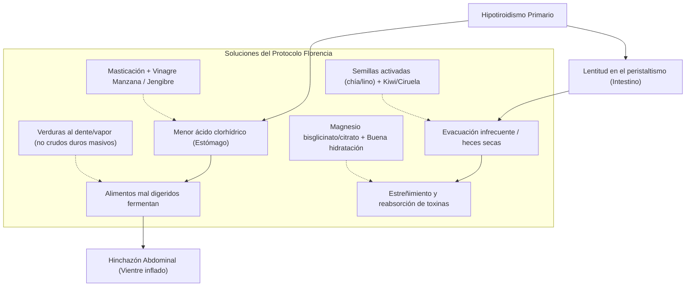

# GUÍA MAESTRA DE REFERENTES, RECETAS ANTIINFLAMATORIAS & PROTOCOLO DIGESTIVO-MOTIVACIONAL

**Atleta:** Florencia  
**Áreas:** Hipotiroidismo, Salud Hormonal Femenina, Ciclo Menstrual, Digestión & Microbiota, Recetas Antiinflamatorias Modulares  

---

## 1. CUADRO DE HONOR DE EXPERTOS Y REFERENTES CIENTÍFICOS

Hemos seleccionado a las máximas autoridades internacionales y de habla hispana que abordan la tiroides, las hormonas femeninas y la salud digestiva desde la raíz inmunometabólica:

### A. Eje Tiroides, Inflamación y Microbiota (La Raíz Clínica)
1. **Dra. Gabriela Pocoví Gerardino (@gabrielapocovi_nutricion)**  
   * *Perfil:* Doctora en Medicina y Salud Pública, Dietista-Nutricionista, especialista en inmunonutrición y autoinmunidad. Autora de *El método antiinflamatorio* y *La solución para la inflamación*.  
   * *Aporte clave para Florencia:* Explicación del **eje intestino-hígado-tiroides**. El 20% de la conversión de T4 (inactiva, como Eutirox) a T3 (activa, metabólica) se da en el intestino gracias a una microbiota sana; si hay inflamación o disbiosis, hay menos T3, más lentitud metabólica, más gases y estreñimiento.
2. **Dra. Izabella Wentz, PharmD (@izabellawentzpharmd)**  
   * *Perfil:* Farmacéutica clínica y máxima referente mundial en Hashimoto e hipotiroidismo. Autora de *Hashimoto's Protocol* y *Adrenal Transformation Protocol*.  
   * *Aporte clave para Florencia:* Protocolos para resolver la hipoclorhidria (falta de ácido estomacal en hipotiroidismo que provoca hinchazón tras comer), optimización del selenio orgánico, tiamina (vitamina B1) para la fatiga aplastante y manejo del estreñimiento refractario.
3. **Dra. Sari Arponen (@drasariarponen)**  
   * *Perfil:* Doctora en Medicina, especialista en Medicina Interna y experta en microbiota. Autora de *¡Es la microbiota, idiota!* y *El sistema inmunitario sale del armario*.  
   * *Aporte clave para Florencia:* Regulación de la barrera intestinal, modulación del agua extracelular (drenaje de retención líquida) y control de la inflamación subclínica.
4. **Dra. Isabel Viña Bas (@isabelvibas)**  
   * *Perfil:* Médico divulgadora en endocrinología integrativa, metabolismo, tiroides y salud de la mujer.  
   * *Aporte clave para Florencia:* Estrategias para combatir la niebla mental y la falta de dopamina/motivación vinculadas a la hipofunción tiroidea, así como el timing circadiano de la levotiroxina y el magnesio.

### B. Salud Hormonal Femenina, Ciclo Menstrual y DIU
1. **Alisa Vitti (@floliving)**  
   * *Perfil:* Nutricionista funcional integrativa, fundadora de FLO Living y pionera del concepto *Cycle Syncing®*. Autora de *WomanCode* e *In the FLO*.  
   * *Aporte clave para Florencia:* Sincronización de los macronutrientes y las cargas de ejercicio según las fases hormonales, optimizando la quema de grasa en fase folicular sin agotar los adrenales en la lútea.
2. **Dr. Jolene Brighten, ND (@drjolenebrighten)**  
   * *Perfil:* Médico naturópata y endocrinóloga funcional femenina. Autora de *Beyond the Pill* y *Is This Normal?*.  
   * *Aporte clave para Florencia:* Manejo de la progestina del DIU Kyleena a nivel local, detoxificación hepática de estrógenos y alivio de cólicos/tensión pélvica mediante magnesio, calor y micronutrición.
3. **Dr. Aviva Romm, MD (@dr.avivaromm)**  
   * *Perfil:* Médico obstetra/ginecóloga formada en Yale y herborista clínica. Autora de *Hormone Intelligence* y *The Adrenal Thyroid Revolution*.  
   * *Aporte clave para Florencia:* El triángulo adrenales-tiroides-ovarios: cómo el estrés y el cortisol bloquean los receptores tiroideos e impiden la recomposición corporal.
4. **Marta León (@foodgreenmood)**  
   * *Perfil:* Ingeniera química especializada en alimentación y salud hormonal femenina. Autora de *Alimentación y salud femenina*.  
   * *Aporte clave para Florencia:* Alimentos botánicos y recetas antiinflamatorias específicas para nutrir el endometrio y la fase folicular/lútea.
5. **Blanca García-Orea Haro (@blancanutri)**  
   * *Perfil:* Nutricionista clínica especializada en aparato digestivo y microbiota. Autora de *Dime qué comes y te diré qué bacterias tienes*.  
   * *Aporte clave para Florencia:* Protocolos inmediatos para el vientre hinchado (meteorismo) y recetas prácticas para el estreñimiento crónico.

---

## 2. CANALES Y BLOGS DE RECETAS PARA INSPIRARNOS Y REPLICAR

Buscamos creadoras que compartan platos **visualmente irresistibles, rápidos, antiinflamatorios y 100% compatibles** con las pautas de Florencia (libres de gluten, sin pescados blancos, con salmón/atún/camarones, aves, huevos, lácteos seleccionados y aderezos emulsionados):

| Creadora / Canal | Plataforma / Enlace | Estilo Gastronómico y Por Qué Nos Sirve |
| :--- | :--- | :--- |
| **Raquel Martin (Raquel's Pantry / Femme & Food)** | Substack: *Pass the Salt* (`raquelspantry.substack.com`) / Linktree: `linktr.ee/Raquels` / IG: `@raquels.pantry` | **Máxima referente en salud femenina y micronutrientes ("A Well-Fed Woman").** Ex-matrona especializada en nutrición para las distintas fases hormonales. Enfoque: *"Serving women's health, one micronutrient at a time"*. Platos visualmente deliciosos con foco en hierro, calcio, magnesio y omega-3, texturas crujientes con semillas y aderezos de tahini y cítricos. Cero sensación de privación. |
| **Annabelle Cassidy & Tom Eterovic** | Substack: *The Anti-Inflammatory Club* (`theantiinflammatoryclub.substack.com`) / IG: `@annabelle_cassidy` | **Referente número 1 en cocina desinflamatoria express.** Cocina modular, ensaladas crujientes con granos limpios (quinoa, arroz basmati), aderezos digestivos de tahini, limón y yogur, fishcakes de salmón y boniato, y sartenadas de cena en 10 minutos diseñadas para deshinchar el abdomen. |
| **Mia Rigden** | Substack: *The Well Journal* / IG: `@miarigden` | Nutricionista de Los Ángeles. Especialista en "The Modular Meal System": bowls con bases de verduras asadas, quinoa/arroz, salmón o pollo marinado con hierbas frescas. |
| **Carissa Stanton (Brocc Your Body)** | IG / Blog: `@broccyourbody` | Creadora de platos hiperfáciles (<20 min) llenos de color y sabor: bowls de camarones salteados con lima y ajo, lomos de salmón glaseados, ensaladas templadas con feta y vinagretas caseras. Muy adaptable a sin gluten. |
| **Paula Monreal (Paufeel)** | IG: `@paufeel` | Referente en España de cocina 100% sin gluten, antiinflamatoria y ultra digestiva. Famosa por sus sartenadas express de cena (huevos con cherrys, tortillas esponjosas, pancakes salados de calabacín y atún). |
| **Elena y María (Futurlife21)** | IG: `@futurlife21` | Bioquímicas y nutricionistas. Expertas en batch cooking antiinflamatorio para la semana, con preparaciones ricas en fibra soluble para combatir el estreñimiento sin generar gases. |
| **Alex Snodgrass (The Defined Dish)** | Blog / IG: `@thedefineddish` | Autora superventas de cocina libre de gluten y antiinflamatoria. Sus marinados para pechuga de pollo y salsas satay de cacahuete con tamari son perfectas para comidas compartidas en pareja. |
| **AJ Foodie** | IG: `@ajfoodie` | Platos limpios y coloridos de inspiración mediterránea y global. Enfoque en aves tiernas (pavo, pollo), carnes magras limpias, verduras crujientes al dente y aliños cítricos sin salsas industriales ni gluten. |
| **Mona Naudts** | IG: `@mona.naudts` | Desayunos y comidas reconfortantes de alta densidad nutricional: shakshukas suaves, huevos poché sobre bases vegetales y bowls coloridos que combinan texturas cremosas y crujientes. |
| **Nutri Aconséjame** | IG: `@nutriaconsejame` | Divulgación de nutrición clínica aplicada, recetas fáciles para desinflamar el intestino, ideas para digestiones lentas y alternativas saciantes ricas en proteína magra. |
| **Erth & Me** | IG: `@erth.and.me` | Creadora de los virales *Snickers Overnight Oats* con capa crujiente de chocolate negro y caramelo de cacahuete, desayunos con avena sin gluten, semillas activadas y proteína limpia. |
| **Emily on Toast** | Substack: `emilyontoast.substack.com` | Especialista en snacks artesanales antiinflamatorios con chocolate negro, frutos secos y semillas tostadas (*Fruit, Nut & Seed Dark Chocolate Bark*), ricos en magnesio y polifenoles. |

---

## 3. PROTOCOLO CLÍNICO: COMBATIR LA HINCHAZÓN Y EL ESTREÑIMIENTO

El hipotiroidismo primario disminuye el metabolismo celular global. Esto causa directamente:
1. **Hipoclorhidria:** El estómago produce menos ácido clorhídrico, provocando digestiones lentas y fermentación de los alimentos en el intestino alto (**hinchazón / sensación de "globo" tras comer**).
2. **Tránsito Intestinal Lento:** La hormona tiroidea T3 es el "motor" del peristaltismo (las contracciones rítmicas del intestino). Con T3 reducida, el intestino se ralentiza y absorbe demasiada agua del bolo fecal (**estreñimiento**).

### Reglas Anti-Hinchazón Inmediatas
* **Cocción Digestiva de Vegetales:** En lugar de ensaladas crudas duras y gigantes (que distienden el vientre), preferir vegetales cocinados al vapor, salteados con AOVE o asados al horno (calabacín, espárragos, espinacas tiernas cocinadas, zanahoria asada, tomates cherry confitados). *(Recordatorio clínico: Remolacha y Berenjena eliminadas 100% de la pauta por aversión/tolerancia de Florencia)*.
* **El Activador de Digestión:** Antes del almuerzo y la cena, un sorbo de agua templada con 1 cucharadita de vinagre de manzana ecológico (sin filtrar) o unas gotas de limón con jengibre rallado para estimular los jugos gástricos de forma natural.
* **Separación de Líquidos:** No beber grandes cantidades de agua fría durante la comida para no diluir el ácido gástrico.

### Reglas Anti-Estreñimiento Inmediatas (Fibra Soluble y Osmosis)
* **Mucílagos de Chía y Lino:** Dejar 1 cucharadita de semillas de chía o lino molido en remojo (en el whipped yogurt o en la masa de las arepas P.A.N.). Los mucílagos crean un gel protector que lubrica las paredes intestinales sin inflamar.
* **El Dúo Matinal de Tránsito:** Incluir en el desayuno manzana tibia cocinada con canela o frutos rojos templados *(Kiwi descartado por aversión de Florencia)*.
* **Magnesio Nocturno Estratégico:** La toma nocturna de magnesio (a las 22:30 h) relaja el músculo liso intestinal y favorece la evacuación suave a la mañana siguiente.
* **Paseo Digestivo Suave:** 10–15 minutos de caminata suave después del almuerzo o la cena estimulan mecánicamente el colon.

---

## 4. PROTOCOLO DE MOTIVACIÓN Y ENERGÍA PARA EL EJERCICIO

En hipotiroidismo, la "falta de motivación" no es debilidad mental ni pereza: **es fatiga fisiológica real** ocasionada por una menor tasa de producción de ATP en las mitocondrias y un sistema dopaminérgico con menor tono. 

Para vencer esto, aplicamos un sistema de **cero fricción y recompensa cerebral inmediata**:

### A. La Regla de los 10 Minutos y el "Anclaje de Asistencia"
* **Meta Reducida de Entrada:** En días de pesadez o baja motivación, el compromiso de Florencia no es "hacer un entrenamiento brutal de 60 minutos", sino únicamente: *"ponerme las mallas, llegar al club O2 y hacer los primeros 10 minutos"*. 
* El 90% de las veces, una vez dentro de la sala, con la música y el ambiente, el cerebro activa la dopamina y completa la sesión con éxito. Si tras 10 minutos el cuerpo sigue genuinamente exhausto, tiene permiso clínico de cambiarse a estiramientos suaves o sauna/ducha reparadora.

### B. Delegación Cognitiva (El Valor de las Clases Dirigidas en O2)
* Florencia no tiene que gastar energía pensando qué ejercicio hacer en una sala solitaria. En **Bodypump, Barre, Ciclo, Pilates o Yoga**, el profesor marca el ritmo, la música aporta energía externa y el grupo impulsa. La mente solo tiene que dejarse llevar.

### C. Sincronización Menstrual del Esfuerzo
* **No forzar la máquina contra la biología:**
  * En **fase folicular (días posteriores a la menstruación):** El estrógeno sube, el estado de ánimo y la energía aumentan de forma natural. Aquí es donde atacamos con ganas las sesiones híbridas (Fuerza + Ciclo) y subimos cargas.
  * En **fase lútea tardía o días de cólicos con el DIU:** No exigir récords. Se sustituyen las clases de impacto por Barre, Pilates o Yoga. Moverse para drenar cortisol, no para castigarse.

### D. Recompensa Sensorial Post-Entreno
* Conectar el entrenamiento con un ritual placentero: la ducha reconfortante en las instalaciones de O2, la cena templada y deliciosa ya preparada de antemano (meal prep), y la sensación de haber drenado el agua y la pesadez del día.

---

## 5. CATÁLOGO DE RECETAS MODULARES "ESTILO ANNABELLE CASSIDY"
*(Inspiradas en las referentes, 100% compatibles con Florencia)*

### Receta 1: "The Glowing Salmon & Quinoa Bowl" (Almuerzo Modular)
* **Base:** 70–80 g de quinoa tricolor cocida con una pizca de cúrcuma y sal marina.
* **Proteína:** Lomo de salmón fresco a la plancha con piel crujiente (sellado con AOVE y sal en escamas).
* **Vegetales Anti-Hinchazón:** Espárragos trigueros salteados al dente, tomates cherry templados y dados de zanahoria asada o calabacín.
* **Emulsión Lemon-Tahini:** 1 cucharada sopera de tahini blanco + zumo de 1/2 limón + 1 cucharada de agua helada + ajo en polvo. Batir hasta obtener una crema sedosa.
* **Efecto Digestivo:** Grasas antiinflamatorias Omega-3, selenio para el tiroides y fibra soluble suave sin provocar hinchazón.

### Receta 2: "Sartenada Expresa de Camarones con Tomates Dulces y Feta" (Cena en 10 min)
* **Ingredientes:** 150 g de colas de camarones/langostinos pelados, 1 taza de tomates cherry cortados por la mitad, 30 g de queso feta desmenuzado, hojas de espinaca tierna, 1 cucharadita de orégano seco y AOVE.
* **Elaboración:** En sartén caliente con AOVE, dorar los camarones 2 minutos. Añadir los cherrys y dejar que se ablanden y suelten su jugo dulce. Apagar el fuego, añadir las espinacas (se cocinan solas con el calor residual) y coronar con el feta desmenuzado y orégano.
* **Efecto Digestivo:** Altísima digestibilidad nocturna, cero pesadez, rica en yodo y zinc.

### Receta 3: "Arepa Tostada de Maíz P.A.N. Anti-Estreñimiento" (Desayuno)
* **Ingredientes:** Harina de maíz precocida P.A.N. blanca o amarilla, agua templada, 1 cucharadita de semillas de chía hidratadas, sal marina. Relleno: Revuelto de 1 huevo campero + 2 claras con 30 g de queso fresco de Burgos o queso cottage.
* **Acompañamiento:** 1/2 kiwi maduro en rodajas y té verde caliente.
* **Efecto Digestivo:** La chía activada aporta mucílagos lubricantes, el kiwi aporta actinidina para activar el tránsito, y la proteína sacia durante horas sin gluten.

---

## 6. NUEVO CATÁLOGO DE RECETAS MODULARES: RAQUEL MARTIN & THE ANTI-INFLAMMATORY CLUB
*(Para rotar en las próximas semanas y evitar la monotonía culinaria con sabores de alta cocina y digestión ultraligera)*

### A. Desayunos & Meriendas Hormonales (Ricos en Magnesio, Calcio & Dopamina)

#### Receta 4 (Raquel Martin): "Warm Jammy Pears con Cardamomo & Crumble de Semillas"
* **Concepto:** Tratamiento de placer y micronutrientes para la fase lútea o mañanas de confort.
* **Ingredientes:** 1 pera madura cortada en cuartos finos, 1 cucharadita de ghee o AOVE, 1/4 cdita de cardamomo molido, 1/2 cdita de canela de Ceilán, 150 g de yogur griego ligero natural (o kéfir), 1 cucharada de pipas de calabaza y 2 nueces de Brasil picadas.
* **Elaboración (5 min):** Saltear las peras en una sartén con el cardamomo y la canela a fuego medio hasta que suelten sus azúcares naturales y queden tiernas y caramelizadas ("jammy"). Servir sobre el yogur frío y coronar con las semillas y nueces crujientes.
* **Efecto Metabólico:** El cardamomo estimula la vesícula biliar y combate los gases; la pera aporta pectina soluble digestiva; las semillas y nueces aportan selenio y magnesio para la tiroides.

#### Receta 5 (The Anti-Inflammatory Club): "Cherry & Cacao Protein Pancakes"
* **Concepto:** Versión reconfortante y antioxidante para variar los pancakes del batch cooking.
* **Ingredientes:** 40 g de harina de avena sin gluten, 1 cazo de proteína AMIX CFM Isolate, 1 cucharada colmada de cacao puro 100% desgrasado, 1 huevo campero + 2 claras, 60 ml de bebida de avena sin gluten, 1 taza de cerezas deshuesadas o frutos rojos (frescos o congelados).
* **Elaboración (8 min):** Batir la masa y cocinar en sartén antiadherente como los pancakes habituales. En paralelo, templar las cerezas en el microondas 1 minuto con unas gotas de limón hasta que formen un sirope caliente natural. Verter por encima de los pancakes.
* **Efecto Metabólico:** Polifenoles de alta potencia (antocianinas) que reducen la PCR (proteína C reactiva) y calman la inflamación articular y muscular post-entreno.

---

### B. Almuerzos & Bowls de Alta Saciedad (Hierro, Zinc & Grano Limpio)

#### Receta 6 (The Anti-Inflammatory Club): "Mediterranean Chicken & Quinoa Crunch Bowl"
* **Concepto:** Almuerzo completo, fresco y crujiente, perfecto para llevar o preparar en 10 minutos.
* **Ingredientes:** 150 g de pechuga de pollo marinada con orégano seco, ralladura de limón y ajo en polvo; 70 g de quinoa cocida con cúrcuma; 1 puñado generoso de canónigos frescos; 10 tomates cherry dulces confitados en sartén; 1/2 calabacín en bastoncitos dorados.
* **Aderezo Emulsionado de Tahini & Lima:** 1 cucharada de tahini blanco + zumo de 1/2 lima + 1 pizca de comino + 1 cucharada de agua fría batida con tenedor hasta emulsionar en crema blanca sedosa.
* **Efecto Metabólico:** Proteína magra limpia sin gluten, carbohidrato de asimilación lenta que no distiende el estómago, y calcio/hierro biodisponible a través del sésamo (tahini).

#### Receta 7 (Raquel Martin): "Bok Choy & Canónigos Calcium Crunch con Salmón al Horno"
* **Concepto:** Foco en calcio biodisponible no lácteo para apoyar la densidad ósea y la función tiroidea.
* **Ingredientes:** 1 lomo de salmón fresco con piel; 2 cogollos de bok choy (o espinacas gruesas) cortados en cuartos longitudinales; 1 bolsa de canónigos; semillas de sésamo tostado; AOVE, jengibre rallado y vinagre de manzana.
* **Elaboración (12 min):** Hornear o sellar el salmón a la plancha con la técnica de piel crujiente. En sartén wok a fuego vivo con 1 cdita de AOVE y jengibre, saltear el bok choy 2–3 minutos (debe quedar al dente, nunca blando ni oxidado). Mezclar con canónigos frescos y servir con el salmón por encima.
* **Efecto Metabólico:** Máxima retención de folato y vitamina C, fibra soluble que previene el estreñimiento sin fermentar en el colon.

#### Receta 8 (The Anti-Inflammatory Club): "Ensalada Templada de Calabaza Asada, Lentejas Rojas y Queso de Cabra Tierno"
* **Concepto:** Alternativa vegetal rica en hierro y minerales para variar las fuentes de legumbres sin hinchazón. *(Recordatorio clínico: Remolacha eliminada 100% de la pauta por aversión)*.
* **Ingredientes:** 100 g de lentejas rojas o pardinas cocidas; 100 g de calabaza asada en dados (del batch); 30 g de queso tierno light o havarti; 1 puñado de canónigos; vinagreta suave de limón, AOVE y orégano.
* **Efecto Metabólico:** Carbohidrato de absorción lenta que nutre la microbiota sin fermentar en el colon, aportando saciedad duradera.

---

### C. Cenas Express & Confort Anti-Hinchazón (<12 Minutos)

#### Receta 9 (The Anti-Inflammatory Club): "Pastelitos Dorados de Salmón y Boniato (Salmon & Sweet Potato Fishcakes)"
* **Concepto:** Una de las recetas insignia más deliciosas y saciantes de Annabelle y Tom.
* **Ingredientes:** 1 lomo de salmón cocinado a la plancha y desmigado (o salmón al vapor); 1 boniato asado mediano chafado con tenedor (de tu batch); 1 cucharadita de cebollino fresco picado; 1/2 cucharadita de mostaza suave de Dijon; 1 pizca de sal y pimienta.
* **Elaboración (8 min):** En un bowl, mezclar el salmón desmigado con el puré de boniato, el cebollino y la mostaza hasta formar una masa manejable. Dividir en 2 hamburguesitas gruesas (fishcakes). Dorar en sartén con 1 cucharadita de AOVE 3 minutos por lado hasta que tengan una costra dorada crujiente.
* **Acompañamiento:** Ensalada limpia de canónigos con limón exprimido.
* **Efecto Metabólico:** Cero gluten, grasas Omega-3 para calmar la inflamación nocturna y almidón de lenta absorción que garantiza un sueño profundo sin picos de cortisol de madrugada.

#### Receta 10 (Raquel Martin): "Sopa Dorada de Zanahoria, Batata y Jengibre con Topping Crujiente"
* **Concepto:** El bálsamo digestivo de Raquel Martin para días de frío, hinchazón o digestión lenta.
* **Ingredientes:** 2 zanahorias y 1 batata asadas (de la bandeja de batch cooking); 200 ml de caldo de verduras o huesos suave; 1 trocito de jengibre fresco rallado (1 cdita); 1/2 cdita de cúrcuma molida; 1 cucharada de semillas de calabaza tostadas con sal marina para coronar.
* **Elaboración (5 min):** Triturar las verduras asadas calientes con el caldo, el jengibre y la cúrcuma hasta obtener una crema brillante y sedosa. Servir en cuenco hondo y añadir las semillas de calabaza tostadas para aportar el contraste crujiente.
* **Efecto Metabólico:** El gingerol del jengibre estimula el vaciado gástrico y previene el reflujo; la cúrcuma desinflama el epitelio intestinal.

#### Receta 11 (Raquel Martin): "Sartenada de Cintas de Calabacín con Gambas al Ajillo y Lima"
* **Concepto:** Cena ultraligera para noches donde Florencia llega cansada y quiere digestión de 0 minutos.
* **Ingredientes:** 1 calabacín verde cortado en cintas con el pelador de patatas; 150 g de colas de gambas peladas; 1 diente de ajo laminado; AOVE, sal marina y zumo de media lima.
* **Elaboración (6 min):** Dorar el ajo y las gambas en sartén caliente con AOVE 2 minutos. Añadir las cintas de calabacín y saltear solo 1,5 minutos (deben quedar al dente, tipo pasta fresca). Exprimir la lima al apagar el fuego.
* **Efecto Metabólico:** Digestión ultra rápida, cero fermentación y alto contenido en zinc y yodo para la síntesis de hormona tiroidea.

---

### D. Antojitos Hormonales Anti-PMS (Magnesio & Serotonina sin Glucosa Disparada)

#### Receta 12 (Raquel Martin): "Bocaditos de Chocolate Negro, Tahini y Flor de Sal"
* **Concepto:** Freno definitivo al antojo dulce de la fase lútea con magnesio biodisponible y grasas saciantes.
* **Ingredientes:** 3 onzas de chocolate negro (>85%) derretidas al microondas (45 seg); 1 cucharada colmada de tahini cremoso; ralladura de 1/2 naranja ecológica; 1 pizca de flor de sal marina en escamas.
* **Elaboración (3 min + enfriar):** Mezclar el chocolate derretido con el tahini y la ralladura de naranja hasta que quede brillante. Verter sobre un platito con papel de horno en pequeños montoncitos y espolvorear unas escamas de sal. Enfriar 15 minutos en el congelador.
* **Efecto Metabólico:** Cada bocado aporta magnesio relajante muscular (calma cólicos y espasmos del DIU) y teobromina que eleva el estado de ánimo sin provocar la hipoglucemia reactiva que causan los dulces industriales.

---

### E. Nuevas Recetas de Creadoras (Sin Pescado ni Marisco para la Rotación Semanal)

#### Receta 13 (Erth & Me): "Snickers Overnight Oats con Cobertura Crujiente de Chocolate y Caramelo de Cacahuete"
* **Concepto:** Desayuno de fin de semana o batch que sabe a tarta de Snickers pero nutre la tiroides y el tránsito intestinal.
* **Ingredientes:**
  * Base de avena: 50 g de harina o copos finos de avena sin gluten, 30 g de proteína en polvo (AMIX CFM Isolate vainilla o proteína vegetal), 100 g de yogur griego natural sin azúcar, 5 g de semillas de chía o lino molido, 10 g de crema de cacahuete en polvo o 1 cdita de crema 100%, 90 ml de bebida de avena sin gluten.
  * Capa de caramelo: 10 g de crema de cacahuete 100% mezclada con 1 cdita (5-10 g) de sirope de arce o miel pura.
  * Cobertura crujiente: 20 g de chocolate negro (>85%) derretido + cacahuetes tostados picados con escamas de sal.
* **Elaboración (5 min + reposo):** Mezclar todos los ingredientes de la base en un tarro de cristal o ramequín. Dejar espesar en nevera 1 hora. Extender la capa de caramelo de cacahuete por encima. Fundir el chocolate negro, verterlo encima formando una capa fina y decorar con los cacahuetes. Dejar en la nevera toda la noche. Al romper la capa crujiente con la cuchara por la mañana se encuentra la textura cremosa.
* **Macros Estimados:** ~440 kcal | 38 g Proteína | 42 g Carbohidratos | 12 g Grasas.

#### Receta 14 (Emily on Toast): "Fruit, Nut & Seed Dark Chocolate Bark"
* **Concepto:** Tableta rota artesanal de chocolate negro con semillas activadas y frutos secos para picoteos saludables de tarde.
* **Ingredientes:** 100 g de chocolate negro (>85%) fundido; 20 g de almendras tostadas troceadas; 15 g de semillas de calabaza; 10 g de semillas de sésamo o chía; 15 g de arándanos secos o trocitos de manzana deshidratada; escamas de flor de sal.
* **Elaboración (8 min + enfriar):** Extender el chocolate fundido sobre papel de horno formando una plancha de 0,5 cm de grosor. Esparcir por encima los frutos secos, semillas y fruta seca presionando suavemente con la yema de los dedos. Espolvorear sal marina y enfriar 30 minutos en nevera. Romper con las manos en trozos irregulares y guardar en bote de cristal.
* **Efecto Metabólico:** Magnesio puro para calmar el útero y la retención premenstrual, con grasas saciantes que no elevan la glucosa.

#### Receta 15 (AJ Foodie): "Solomillitos de Pavo al Limón, Romero y Boniato Dorado"
* **Concepto:** Almuerzo limpio de alta proteína magra para días donde quieres digestión ligera y cero pesadez.
* **Ingredientes:** 180 g de solomillo de pavo cortado en medallones; 150 g de boniato asado en dados (del batch prep); 1 diente de ajo picado; zumo de 1/2 limón; romero fresco picado; 1 cdita de AOVE virgen extra; ensalada de canónigos frescos.
* **Elaboración (10 min):** Dorar los medallones de pavo en sartén caliente con el AOVE, ajo y romero 3 minutos por lado. Añadir el zumo de limón para desglasar la sartén. Servir con los dados de boniato caliente y los canónigos con aliño de limón.
* **Macros Estimados:** ~420 kcal | 44 g Proteína | 38 g Carbohidratos | 8 g Grasas.

#### Receta 16 (AJ Foodie / Nutri Aconséjame): "Wok Rápido de Tiras de Ternera Limpia con Calabacín, Zanahoria y Arroz Basmati"
* **Concepto:** Hierro hemo de máxima absorción para la fase premenstrual en un formato rápido estilo salteado asiático sin gluten.
* **Ingredientes:** 150 g de filetes de ternera magra cortados en tiras finas; 1 calabacín verde en medias lunas; 1 zanahoria en bastones finos; 120 g de arroz basmati cocido (o quinoa); 1 cucharada de tamari (salsa de soja 100% sin gluten); 1 cdita de semillas de sésamo; 1 cdita de AOVE.
* **Elaboración (8 min):** En sartén bien caliente o wok con el AOVE, saltear las verduras a fuego vivo 3 minutos (al dente). Retirar las verduras, saltear las tiras de ternera 1,5 minutos. Reincorporar las verduras, añadir el tamari y remover 30 segundos. Servir sobre el arroz basmati y coronar con sésamo.
* **Macros Estimados:** ~450 kcal | 42 g Proteína | 44 g Carbohidratos | 11 g Grasas.

#### Receta 17 (Mona Naudts): "Shakshuka Suave de Huevos Camperos con Tomate Confitado, Albahaca y Tortitas de Maíz"
* **Concepto:** Cena tibia de confort digestivo, sin digestiones pesadas y con yema líquida para mojar tortitas de maíz crujientes.
* **Ingredientes:** 2 huevos camperos enteros + 2 cucharadas de claras; 150 g de tomate triturado dulce natural; 1/2 calabacín en dados pequeños; 1 cdita de orégano y albahaca fresca; sal marina y 1 cdita de AOVE; 2 tortitas de maíz 100% sin gluten tostadas.
* **Elaboración (10 min):** Sofreír el calabacín en una sartén pequeña con AOVE 3 minutos. Añadir el tomate triturado, sal y orégano, y cocinar 3 minutos a fuego medio. Hacer dos huecos con la espátula y cascar los huevos dentro. Tapar y dejar cuajar a fuego suave 3–4 minutos (claras cuajadas, yemas líquidas). Espolvorear albahaca y servir con las tortitas calientes.
* **Macros Estimados:** ~390 kcal | 26 g Proteína | 32 g Carbohidratos | 15 g Grasas.

#### Receta 18 (Nutri Aconséjame): "Pollo Salteado al Curry Suave y Leche de Coco Ligera con Quinoa"
* **Concepto:** Cena antiinflamatoria donde la cúrcuma calma el epitelio intestinal y el pollo aporta proteína magra saciante.
* **Ingredientes:** 160 g de pechuga de pollo en dados; 60 ml de leche de coco ligera (sin espesantes químicos); 1/2 cdita de curry en polvo suave; 1/2 cdita de cúrcuma; 1 calabacín pequeño en dados; 100 g de quinoa cocida.
* **Elaboración (10 min):** Dorar el pollo en sartén con unas gotas de AOVE 4 minutos. Añadir el calabacín y saltear 2 minutos. Verter la leche de coco ligera y las especias, reduciendo a fuego lento 3 minutos hasta que la salsa quede cremosa. Servir junto a la quinoa tibia.
* **Macros Estimados:** ~440 kcal | 43 g Proteína | 36 g Carbohidratos | 12 g Grasas.
